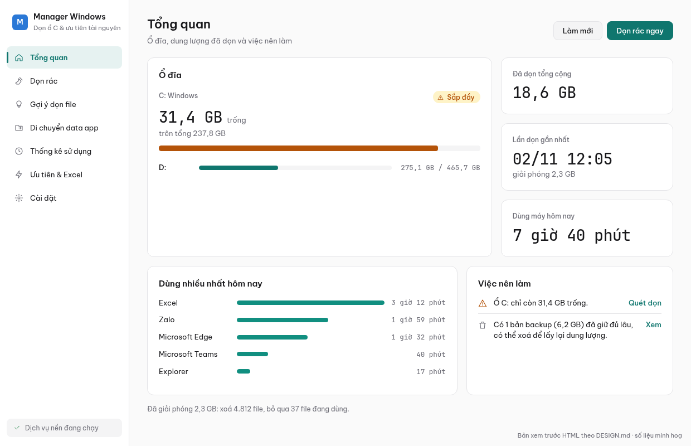

# Manager Windows

App chạy nền trên Windows 10/11 (x64) giúp:

1. **Dọn rác định kỳ**: file tạm, cache Windows Update, cache trình duyệt/Teams/Zalo, dump lỗi, Thùng rác…
2. **Gợi ý dọn file**: file lâu không dùng, file lớn, bộ cài cũ trong Downloads, file trùng nhau. App chỉ gợi ý, không bao giờ tự xoá.
3. **Chuyển data app khỏi ổ C** (Zalo, Telegram, Chrome/Edge, backup iPhone…). Data được chuyển sang ổ khác, đường dẫn cũ trên ổ C giữ nguyên nhờ *junction* nên app vẫn chạy bình thường. Có Hoàn tác.
4. **Theo dõi tần suất dùng app**: thời gian dùng thật (không tính lúc máy rảnh), số lần mở, biểu đồ theo giờ.
5. **Ưu tiên tài nguyên**: app dùng nhiều nhất hoặc app được ghim được ưu tiên CPU; app nền (OneDrive, updater…) bị hạ ưu tiên và chạy chế độ tiết kiệm (EcoQoS).
6. **Theo dõi tiến trình**:
   - Xem app nào đang chiếm CPU, RAM, ổ đĩa (gộp tiến trình theo app), phân loại Ứng dụng / Chạy ngầm / Hệ thống.
   - Chẩn đoán lag: khi ổ đĩa, CPU hoặc RAM quá tải, chỉ ra app dùng nhiều nhất.
   - Khởi động lại app; kiểm tra tiến trình sót (mồ côi, treo, chạy ngầm lâu không hoạt động) và dừng các mục được chọn.
   - Ngủ đông app không dùng (mặc định 15 phút, tắt sẵn): tạm dừng app cùng tiến trình chạy ngầm của nó, trả RAM/CPU; bấm vào app là chạy tiếp đúng trạng thái cũ. Không áp dụng cho app nhắn tin, nhạc, app đang phát âm thanh/đang làm việc.
   - End task, giải phóng RAM từng app hoặc toàn máy (kèm xả bộ nhớ đệm standby qua dịch vụ nền).
   - Cảnh báo ở khay khi một app chạy ngầm dùng nhiều CPU/RAM liên tục.
7. **Excel nặng**:
   - Khi phát hiện Excel đang mở file nặng, app tự ưu tiên tài nguyên cho Excel.
   - App đọc thẳng file .xlsx để tìm nguyên nhân làm file nặng: vùng dữ liệu "ma", quá nhiều style, hàm tự tính lại (INDIRECT/OFFSET…), liên kết ngoài, ảnh lớn, Office 32-bit…
   - Từ đó app đưa ra cách xử lý cụ thể.

Giao diện kiểu dashboard, có tiếng Việt và tiếng Anh. Chế độ sáng/tối tự theo Windows, hoặc chọn cố định trong phần Cài đặt.



## Thiết kế giao diện

Giao diện được thiết kế bằng bộ skill [Google Stitch](https://github.com/google-labs-code/stitch-skills):

| File | Nội dung |
|---|---|
| [`docs/design/DESIGN.md`](docs/design/DESIGN.md) | Hệ thống thiết kế, viết bằng skill `taste-design`: màu sáng/tối, font, thành phần, bố cục, những điều cấm. Đây là chuẩn duy nhất cho giao diện WPF. |
| [`docs/design/stitch-prompts.md`](docs/design/stitch-prompts.md) | Prompt cho từng màn, viết bằng skill `enhance-prompt`. Dán vào [stitch.withgoogle.com](https://stitch.withgoogle.com) hoặc dùng skill `generate-design` (cần Stitch API key) để sinh bản vẽ. |
| `docs/design/preview/` | Bản xem trước HTML của màn Tổng quan (sáng/tối), dùng số liệu minh hoạ |

Font nhúng trong app: Be Vietnam Pro và JetBrains Mono (giấy phép OFL, xem `licenses/`). Biểu tượng: Segoe Fluent Icons trên Windows 11, Segoe MDL2 Assets trên Windows 10.

## Tải về

Vào mục [Releases](https://github.com/quangns/manager_windows/releases), có 2 bản:

| Bản | File | Dùng khi |
|---|---|---|
| **Portable** | `ManagerWindows-<version>-win-x64-portable.zip` | Chỉ 1 file exe + hướng dẫn: chép exe vào đâu cũng chạy, không cần quyền admin, không cài gì vào máy |
| **Cài đặt** | `ManagerWindows-<version>-win-x64.zip` | Muốn đủ tính năng (dịch vụ nền dọn thư mục hệ thống, đếm số lần mở app, ưu tiên cả process chạy quyền admin) |

Cả 2 bản đã kèm .NET runtime, không cần cài thêm gì. Hai bản build từ cùng một mã nguồn; bản portable chỉ khác ở chỗ gộp thành một file exe và lưu dữ liệu cạnh exe (script đóng gói tự kiểm tra không lẫn hai bản). Mỗi lúc chỉ chạy được một bản: mở bản này khi bản kia đang chạy dưới khay, app sẽ hỏi có đóng bản kia không. Phiên bản và loại bản hiện ở góc trên bên trái cửa sổ. Kiểm tra file tải về bằng `SHA256SUMS.txt`.

### Bản portable

Gói portable chỉ có `ManagerWindows.App.exe` (đã gồm .NET runtime, thư viện, font, luật dọn rác) và `Huong-dan-su-dung.txt`.

1. Chép `ManagerWindows.App.exe` vào một thư mục riêng, ví dụ `D:\Tools\ManagerWindows\`.
2. Chạy exe; lần đầu mất vài giây để giải nén thư viện vào thư mục tạm. Biểu tượng app nằm ở khay hệ thống.
3. Mọi dữ liệu nằm trong thư mục `data` cạnh file exe. Mặc định app không tự chạy cùng Windows; bật trong phần Cài đặt nếu cần.

Bản portable dọn rác của người dùng, gợi ý file, chuyển data, thống kê thời gian dùng và ưu tiên app như bản cài đặt. Những phần cần dịch vụ nền thì không có:
- Không dọn được `C:\Windows\Temp` và cache Windows Update.
- Không đếm được số lần mở app.

Trước khi xoá thư mục portable, nếu đã chuyển data app sang ổ khác, hãy bấm Hoàn tác trong app. Nếu không hoàn tác thì Zalo… vẫn chạy bình thường vì junction vẫn còn.

### Bản cài đặt

1. Giải nén rồi chạy `install.cmd` (Windows sẽ hỏi quyền admin).
   - App được cài vào `C:\Program Files\ManagerWindows` và đăng ký dịch vụ nền `ManagerWindowsService`.
   - Shortcut được tạo trong Start Menu; app tự mở và nằm ở khay hệ thống.
2. Gỡ cài đặt: chạy `uninstall.ps1` trong thư mục cài đặt. Mặc định các thư mục data đã chuyển sẽ được đưa về lại ổ C trước khi gỡ.
   - Thêm `-KeepRelocations` để giữ nguyên các thư mục đã chuyển.
   - Thêm `-RemoveData` để xoá luôn thống kê và cấu hình.

## Kiến trúc

```
ManagerWindows.App (WPF, khay hệ thống, quyền người dùng)
 ├─ dọn rác phần của user, chuyển data AppData (junction), theo dõi cửa sổ đang dùng
 ├─ điều phối ưu tiên process của user, phân tích file Excel
 └─ named pipe ──► ManagerWindows.Service (Windows Service, quyền SYSTEM)
                    ├─ dọn rác hệ thống theo lịch (Windows\Temp, SoftwareDistribution, WER…)
                    ├─ đếm số lần mở app (WMI Win32_ProcessStartTrace)
                    └─ đặt ưu tiên cho process chạy quyền admin
```

| Project | Nội dung |
|---|---|
| `src/ManagerWindows.Core` | Logic thuần, test được trên Linux: luật dọn, quét gợi ý, file trùng, máy trạng thái chuyển data, gom phiên sử dụng, chính sách ưu tiên, phân tích xlsx, lịch |
| `src/ManagerWindows.Platform` | Win32 API: junction (FSCTL_SET_REPARSE_POINT), Thùng rác, SetPriorityClass/EcoQoS, cửa sổ đang dùng, thời gian rảnh, thông tin Office |
| `src/ManagerWindows.Storage` | SQLite: lịch sử dọn, các lần chuyển data, phiên sử dụng, số lần mở |
| `src/ManagerWindows.Ipc` | Định nghĩa lệnh và client của named pipe |
| `src/ManagerWindows.Service` | Windows Service |
| `src/ManagerWindows.App` | Giao diện WPF + các vòng lặp chạy nền |
| `rules/cleanup-rules.json` | Luật dọn rác (sửa được, không cần build lại) |
| `rules/app-profiles.json` | Hồ sơ thư mục data của từng app (Zalo, Telegram…) |

Dữ liệu được lưu tại:
- `%LOCALAPPDATA%\ManagerWindows\`: `config.json`, `data.db` và thư mục `logs\`, riêng cho từng user.
- `%ProgramData%\ManagerWindows\`: `service.db` và `service.json` (lịch dọn rác hệ thống).

Mọi dữ liệu chỉ lưu trên máy, không gửi đi đâu.

## Các nguyên tắc an toàn

- **Dọn rác:**
  - Luôn có bước chạy thử để xem trước dung lượng.
  - Sau khi chạy thử, bấm "Xem file" ở từng mục để xem danh sách file và bỏ tick những file muốn giữ. Mục "nên xem lại" (cache Zalo, Teams, Thùng rác) bắt buộc phải xem trước khi dọn; dọn tự động và nút "Dọn rác ngay" luôn bỏ qua các mục này.
  - Không đi theo junction/symlink khi quét, nên không xoá nhầm data đã chuyển sang ổ khác.
  - Chặn các luật trỏ vào gốc ổ đĩa, thư mục Windows hoặc hồ sơ người dùng.
  - Ngay trước khi xoá, kiểm tra lại tuổi của từng file. File đang mở thì bỏ qua.
- **Chuyển data:**
  - Kiểm tra trước: ổ đích phải là NTFS, là ổ gắn trong (không dùng USB/ổ mạng), đủ dung lượng và khác ổ với nguồn.
  - Đóng app trước khi chuyển; copy bằng robocopy rồi so khớp số file và tổng dung lượng.
  - Bản gốc được đổi tên thành `*.mwbak` và giữ lại để hoàn tác.
  - Mỗi bước được lưu lại, nên nếu bị ngắt giữa chừng (mất điện…) vẫn làm tiếp hoặc hoàn tác được.
  - Mỗi giờ app kiểm tra junction còn trỏ đúng chỗ không.
  - Thư mục đích (`D:\AppDataMoved\<user>`) chỉ user đó, SYSTEM và Administrators truy cập được.
- **Ưu tiên tài nguyên:**
  - Không bao giờ dùng mức Realtime; mức High chỉ dùng khi người dùng tự bật.
  - Không đụng tiến trình hệ thống và phần mềm diệt virus.
  - Khi tắt tính năng hoặc thoát app, các process được trả về mức ưu tiên ban đầu.
- **Dịch vụ nền:**
  - Named pipe chỉ cho phép người dùng đang đăng nhập (INTERACTIVE), SYSTEM và Administrators kết nối.
  - Chỉ nhận một số lệnh cố định, không có lệnh nào nhận đường dẫn để xoá.
  - Chỉ đổi ưu tiên cho process cùng phiên đăng nhập với người gửi lệnh.

## Phát triển

Yêu cầu .NET 10 SDK (LTS). Mọi điều khiển WPF được vẽ bằng style riêng theo `docs/design/DESIGN.md` (không phụ thuộc theme Fluent/Aero của máy). Code build và test được trên Linux (các project Windows nhờ `EnableWindowsTargeting`), nhưng app chỉ chạy được trên Windows.

```bash
dotnet test tests/ManagerWindows.Core.Tests      # 47 test: Core + Storage + IPC
./scripts/build-release.sh                       # → dist/*.zip: bản cài đặt + bản portable + SHA256SUMS.txt
```

Trong container ChatWork, SDK nằm ở `/workspace/.toolchain/dotnet`; đặt `DOTNET=/workspace/.toolchain/dotnet/dotnet` nếu `dotnet` không có trong PATH.

Mẫu CI chạy trên máy Windows thật nằm ở `docs/ci/windows-build.yml`; copy sang `.github/workflows/` để bật.

### Thêm app vào danh sách chuyển data

Thêm một mục vào `rules/app-profiles.json`:

```json
{
  "id": "myapp",
  "name": "My App",
  "processNames": [ "MyApp" ],
  "folders": [ "%APPDATA%\\MyApp" ],
  "notes": { "vi": "Ghi chú", "en": "Note" }
}
```

App nào không chạy được sau junction (Outlook, OneDrive, WSL…) thì đặt `"method": "Manual"` và ghi hướng dẫn cách chuyển vào `notes`.

## Hạn chế đã biết

- Thời gian dùng app được tính theo cửa sổ đang dùng và có thao tác phím/chuột. Xem video lâu không chạm chuột sẽ bị tính là máy rảnh sau 2 phút (chỉnh `Usage.IdleSeconds` trong `config.json`).
- File Excel đang mở được đoán từ tiêu đề cửa sổ và danh sách file mở gần đây. File mở từ SharePoint/OneDrive dạng URL không phân tích được, nhưng app vẫn phát hiện Excel nặng theo RAM/CPU.
- Định dạng .xls và .xlsb là nhị phân nên chỉ có gợi ý chung.
- Junction chỉ hoạt động trên ổ NTFS gắn trong máy.
